# Sistema de Gestión de Stock — Concesionaria Multimarcas

Proyecto Java estándar (JDK 17+, probado con JDK 25), sin frameworks externos.
Arquitectura en capas, POO completa, persistencia CSV y consola interactiva.

## Estructura de carpetas

```text
Default Project/
├── excepciones/
│   ├── DatoInvalidoException.java
│   ├── KilometrajeInconsistenteException.java
│   ├── VehiculoDuplicadoException.java
│   └── VehiculoNoEncontradoException.java
├── modelo/
│   ├── Vendible.java
│   ├── Tasable.java
│   ├── EstadoVehiculo.java
│   ├── TipoVehiculo.java
│   ├── TipoCarroceria.java
│   ├── TipoCabina.java
│   ├── TipoTraccion.java
│   ├── EstiloMotocicleta.java
│   ├── Vehiculo.java
│   ├── Automovil.java
│   ├── Camioneta.java
│   ├── Motocicleta.java
│   └── SimulacionVenta.java
├── repositorio/
│   ├── IRepositorio.java
│   ├── IRepositorioPersistible.java
│   ├── RepositorioGenerico.java
│   ├── RepositorioVehiculos.java
│   └── CsvVehiculoCodec.java
├── servicio/
│   └── ServicioVehiculos.java
├── util/
│   ├── Validador.java
│   └── LecturaConsola.java
├── vista/
│   ├── Main.java
│   ├── ConsolaApp.java
│   └── FormateadorSalida.java
├── web/
│   ├── ServidorWeb.java
│   └── Json.java
├── web-static/
│   ├── index.html
│   ├── styles.css
│   └── app.js
└── README.md
```

## Compilación y ejecución

PowerShell (Windows):

```powershell
javac -encoding UTF-8 -d out (Get-ChildItem -Recurse -Filter *.java | ForEach-Object { $_.FullName })
java -Dfile.encoding=UTF-8 -cp out vista.Main
```

Bash / macOS / Linux:

```bash
javac -encoding UTF-8 -d out $(find . -name "*.java")
java -cp out vista.Main
```

### Aplicación web

La capa `web` reutiliza el mismo `ServicioVehiculos` (no duplica reglas de negocio)
y expone una API REST con `ServerSocket`, sin frameworks. Los archivos de la
interfaz están en `web-static/`.

```powershell
java "-Dfile.encoding=UTF-8" -cp out web.ServidorWeb 8080 web-static
```

Luego abrir **http://localhost:8080**. El servidor acepta opcionalmente
`puerto` y `directorio-estatico` como argumentos.

Endpoints:

| Método | Ruta | Uso |
|---|---|---|
| GET | `/api/opciones` | enums del dominio para los formularios |
| GET | `/api/vehiculos?tipo=&estado=&marca=` | listado y filtros |
| POST | `/api/vehiculos` | alta (form-urlencoded) |
| PUT | `/api/vehiculos/{id}/precio` | modificar precio |
| PUT | `/api/vehiculos/{id}/color` | modificar color |
| DELETE | `/api/vehiculos/{id}` | baja |
| POST | `/api/simulacion` | simular venta con descuento |

El archivo `stock.csv` se crea automáticamente en el directorio de ejecución;
se carga al iniciar (consola o web) y se reescribe tras cada cambio.

Para generar un stock de demostración con 73 vehículos (25 autos, 24 camionetas
y 24 motos):

```powershell
powershell -ExecutionPolicy Bypass -File scripts/generar-stock-demo.ps1
```

El script usa Base64 URL-safe, coincide con `CsvVehiculoCodec` y respeta las
reglas `NUEVO = 0 km` / `USADO > 0 km`.

## Decisiones de diseño principales

- **Dominio puro:** `Vehiculo` es abstracta, implementa `Serializable`, `Vendible` y
  `Tasable`; declara `obtenerTipo()`, `obtenerFichaTecnicaDetallada()`,
  `calcularImpuestoPatente()` y `validarReglasEspecificas()` como abstractas.
- **Identidad y colecciones:** `equals()`/`hashCode()` se basan en el identificador;
  el repositorio usa `LinkedHashMap` indexado por id y expone `List` en `listarTodos()`.
- **Sin duplicados:** el id se valida en el servicio y se garantiza en el repositorio.
- **Wrappers:** todos los atributos numéricos son `Integer`/`Double`, con conversiones
  centralizadas en `util.Validador`.
- **Coherencia de estado:** `NUEVO` exige 0 km y `USADO` exige más de 0 km
  (`KilometrajeInconsistenteException`).
- **Persistencia polimórfica:** cada línea CSV lleva el tipo concreto en el primer
  campo; los textos se codifican en Base64 URL para soportar acentos y delimitadores.
- **Simulación sin efectos colaterales:** `aplicarDescuento()` devuelve el precio
  calculado sin modificar el stock.
- **Robustez:** `NumberFormatException`, `InputMismatchException`, `IOException` y
  excepciones de dominio se capturan; el programa nunca termina de forma abrupta.

## Diagrama de clases UML (Mermaid)

```mermaid
classDiagram
direction TB

class Vehiculo {
  <<abstract>>
  -String identificador
  -String marca
  -String modelo
  -Integer anio
  -String color
  -EstadoVehiculo estado
  -Double kilometraje
  -Double precio
  +Vehiculo(identificador, marca, modelo, anio, color, estado, kilometraje, precio)
  +obtenerTipo()* TipoVehiculo
  +obtenerFichaTecnicaDetallada()* String
  +validar() void
  #validarReglasEspecificas()* void
  #redondear(Double) Double
  +calcularImpuestoPatente()* Double
  +calcularValorTasado() Double
  +calcularPrecioFinalVenta() Double
  +aplicarDescuento(Double) Double
  +equals(Object) boolean
  +hashCode() int
  +toString() String
}

class Automovil {
  -TipoCarroceria carroceria
  -Integer puertas
  +Automovil(...)
  +obtenerTipo() TipoVehiculo
  +obtenerFichaTecnicaDetallada() String
  +validarReglasEspecificas() void
  +calcularImpuestoPatente() Double
  +toString() String
}

class Camioneta {
  -TipoCabina cabina
  -TipoTraccion traccion
  -Double capacidadCarga
  +Camioneta(...)
  +obtenerTipo() TipoVehiculo
  +obtenerFichaTecnicaDetallada() String
  +validarReglasEspecificas() void
  +calcularImpuestoPatente() Double
  +toString() String
}

class Motocicleta {
  -EstiloMotocicleta estilo
  -Integer cilindrada
  +Motocicleta(...)
  +obtenerTipo() TipoVehiculo
  +obtenerFichaTecnicaDetallada() String
  +validarReglasEspecificas() void
  +calcularImpuestoPatente() Double
  +toString() String
}

class Vendible {
  <<interface>>
  +calcularPrecioFinalVenta() Double
  +aplicarDescuento(Double) Double
}

class Tasable {
  <<interface>>
  +calcularImpuestoPatente() Double
  +calcularValorTasado() Double
}

class SimulacionVenta {
  -Vehiculo vehiculo
  -Double porcentajeDescuento
  -Double precioFinal
  -Double impuestoPatente
  -Double valorTasado
  -Double total
  +SimulacionVenta(...)
  +getVehiculo() Vehiculo
  +getPorcentajeDescuento() Double
  +getPrecioFinal() Double
  +getImpuestoPatente() Double
  +getValorTasado() Double
  +getTotal() Double
}

class EstadoVehiculo {
  <<enumeration>>
  NUEVO
  USADO
  +getEtiqueta() String
}
class TipoVehiculo {
  <<enumeration>>
  AUTOMOVIL
  CAMIONETA
  MOTOCICLETA
  +getEtiqueta() String
}
class TipoCarroceria {
  <<enumeration>>
  SEDAN
  HATCHBACK
  COUPE
  SUV
  FAMILIAR
  CONVERTIBLE
}
class TipoCabina {
  <<enumeration>>
  CABINA_SIMPLE
  DOBLE_CABINA
  UTILITARIO
}
class TipoTraccion {
  <<enumeration>>
  TRACCION_4X2
  TRACCION_4X4
}
class EstiloMotocicleta {
  <<enumeration>>
  NAKED
  ENDURO
  TOURING
  SCOOTER
  DEPORTIVA
  CUSTOM
}

class IRepositorio~T, ID~ {
  <<interface>>
  +agregar(T) void
  +buscarPorId(ID) T
  +listarTodos() List~T~
  +actualizar(T) void
  +eliminar(ID) void
}
class IRepositorioPersistible~T, ID~ {
  <<interface>>
  +cargar() void
  +guardar() void
}
class RepositorioGenerico~T, ID~ {
  #Map~ID, T~ entidades
  #Function~T, ID~ extractorId
  +RepositorioGenerico(Function~T, ID~)
  +agregar(T) void
  +buscarPorId(ID) T
  +listarTodos() List~T~
  +actualizar(T) void
  +eliminar(ID) void
  #reemplazarTodo(Collection~T~) void
}
class RepositorioVehiculos {
  -Path archivo
  +RepositorioVehiculos()
  +RepositorioVehiculos(Path)
  +cargar() void
  +guardar() void
  +getArchivo() Path
}
class CsvVehiculoCodec {
  <<final>>
  +serialize(Vehiculo) String
  +deserialize(String) Vehiculo
}

class ServicioVehiculos {
  -IRepositorioPersistible~Vehiculo, String~ repositorio
  +ServicioVehiculos(IRepositorioPersistible)
  +inicializar() void
  +darDeAlta(Vehiculo) void
  +buscarPorId(String) Vehiculo
  +listarTodos() List~Vehiculo~
  +listarPorTipo(TipoVehiculo) List~Vehiculo~
  +listarPorEstado(EstadoVehiculo) List~Vehiculo~
  +listarPorMarca(String) List~Vehiculo~
  +cambiarPrecio(String, Double) void
  +cambiarColor(String, String) void
  +darDeBaja(String) void
  +simularVenta(String, Double) SimulacionVenta
  +guardar() void
}

class Validador {
  <<final>>
  +validarTextoNoVacio(String, String) String
  +parsearEntero(String, String) Integer
  +parsearDouble(String, String) Double
  +validarAnio(Integer) Integer
  +validarPrecio(Double) Double
  +validarKilometraje(Double) Double
  +validarEnteroPositivo(Integer, String) Integer
  +validarPorcentaje(Double) Double
  +parsearEnum(String, Class~E~) E
}
class LecturaConsola {
  -Scanner scanner
  +leerTexto(String) String
  +leerEntero(String, Integer, Integer) Integer
  +leerDouble(String, Double, Double) Double
  +leerEnum(String, Class~E~) E
  +leerSiNo(String) Boolean
  +limpiarBuffer() void
}
class ConsolaApp {
  -LecturaConsola lector
  -RepositorioVehiculos repositorio
  -ServicioVehiculos servicio
  +iniciar() void
}
class FormateadorSalida {
  <<final>>
  +tabla(List~Vehiculo~) String
  +ficha(Vehiculo) String
  +simulacion(SimulacionVenta) String
}
class Main {
  <<final>>
  +main(String[]) void
}

class ServidorWeb {
  -ServicioVehiculos servicio
  -Path raizEstatica
  -Integer puerto
  +iniciar() void
  +detener() void
  +main(String[]) void
  #api(String, String, Map) Respuesta
  #construirVehiculo(Map) Vehiculo
  #estatico(String) Respuesta
}
class Json {
  <<final>>
  +escape(String) String
  +vehiculo(Vehiculo) String
  +lista(List~Vehiculo~) String
  +simulacion(SimulacionVenta) String
  +opciones() String
  +error(String) String
  +mensaje(String) String
}
class DatoInvalidoException
class KilometrajeInconsistenteException
class VehiculoDuplicadoException
class VehiculoNoEncontradoException

Vehiculo <|-- Automovil
Vehiculo <|-- Camioneta
Vehiculo <|-- Motocicleta
Vehiculo ..|> Vendible
Vehiculo ..|> Tasable
Vehiculo --> EstadoVehiculo
Automovil --> TipoCarroceria
Camioneta --> TipoCabina
Camioneta --> TipoTraccion
Motocicleta --> EstiloMotocicleta
Vehiculo ..> DatoInvalidoException
Vehiculo ..> KilometrajeInconsistenteException
KilometrajeInconsistenteException --|> DatoInvalidoException

SimulacionVenta --> Vehiculo
IRepositorio <|.. IRepositorioPersistible
IRepositorio <|.. RepositorioGenerico
RepositorioGenerico <|-- RepositorioVehiculos
RepositorioVehiculos ..|> IRepositorioPersistible
RepositorioVehiculos "1" *-- "0..*" Vehiculo
RepositorioVehiculos ..> CsvVehiculoCodec
RepositorioVehiculos ..> DatoInvalidoException
RepositorioVehiculos ..> VehiculoDuplicadoException
RepositorioVehiculos ..> VehiculoNoEncontradoException
CsvVehiculoCodec ..> Validador
CsvVehiculoCodec ..> Vehiculo

ServicioVehiculos --> IRepositorioPersistible
ServicioVehiculos ..> Validador
ServicioVehiculos ..> SimulacionVenta
ServicioVehiculos ..> TipoVehiculo
ServicioVehiculos ..> EstadoVehiculo
ServicioVehiculos ..> DatoInvalidoException
ServicioVehiculos ..> VehiculoDuplicadoException
ServicioVehiculos ..> VehiculoNoEncontradoException

LecturaConsola ..> Validador
ConsolaApp --> ServicioVehiculos
ConsolaApp --> RepositorioVehiculos
ConsolaApp --> LecturaConsola
ConsolaApp ..> FormateadorSalida
FormateadorSalida ..> Vehiculo
FormateadorSalida ..> SimulacionVenta
Main --> ConsolaApp
ServidorWeb --> ServicioVehiculos
ServidorWeb --> RepositorioVehiculos
ServidorWeb ..> Json
ServidorWeb ..> Validador
ServidorWeb ..> DatoInvalidoException
ServidorWeb ..> Vehiculo
ServidorWeb ..> SimulacionVenta
```


